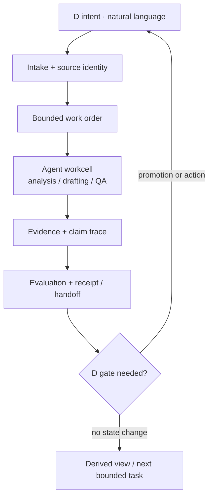

# AEQ · Agentic AI System Architecture & Engineering Harness

## Source Intake + Workflow Orientation — v0.1 DRAFT

```yaml
artifact_id: AEQ_AGENTIC_AI_HARNESS_SOURCE_INTAKE_AND_WORKFLOW_20260928_v0_1_DRAFT
date_local: 2026-09-28
status: DRAFT_FOR_D_REVIEW
mode: READ_ONLY · SOURCE_BOUND · DERIVATIVE_ONLY · NO_PROJECT_STATE_MUTATION
authority: D / Aleja
scope: >
  Orientation for a governed Agentic AI System Architecture & Engineering Harness.
  This is a design and intake artifact, not a runtime, deployment, merge,
  synchronization, canonization, or implementation authorization.
mutation_performed: false
canon_declared: false
runtime: false
deployment: false
sync: false
source_intake:
  source_provided_by: D / Aleja
  recent_uploads_located: 20
  content_inspected_at_intake: 20
  inspection_depth: >
    Titles, metadata, table of contents or opening sections for all; targeted
    passages for architecture, governance, MCP and scaffolding sources. Long
    books/proceedings were not read end-to-end in this intake.
  source_admission_state: SOURCE_UNVALIDATED
```

## 1. The orientation in one sentence

**Build a governed engineering harness around AI work, not an unbounded “agent
fleet”:** every task begins with a human-intent work order and a bounded source
set; agents may analyze or draft, but their output is traceable, evaluated,
receipted, and stops at D/Aleja whenever it would alter project state.

The harness is the reusable operating envelope for multiple models and tools.
It is **not** proof that a multi-agent runtime, MCP server, shared memory,
vector store, or synchronization mechanism already exists.



## 2. Non-negotiable alignment with the current AEQ baseline

This draft preserves the control-contract distinctions:

```text
SOURCE ≠ RECONSTRUCTION ≠ CLAIM ≠ VERIFIED ≠ CANON
ACCOUNT ≠ SESSION ≠ PROJECT ≠ CHAT ≠ ROLE ≠ AUTHORITY
artifact ≠ runtime
visual maturity ≠ epistemic authority
```

It therefore adopts these design constraints from the mounted AEQ contracts:

1. A new upload is a **provided source**, not an automatically validated or
   governing source. Its provenance, inspection state and independence remain
   visible.
2. Normalization and a “current view” are derived outputs; neither may quietly
   become a source of truth.
3. Agent role assignment, a skill, a mock, a visual simulation or a receipt
   does not demonstrate general capability or runtime integration.
4. Every consequential state transition remains behind D’s human gate.
5. A prototype must first pass a read-only dry-run that exercises missing
   sources, circular verification, self-approval, stale state, concurrent
   conflict, normalization and handoff/receipt behavior.

## 3. Recent-source intake register

All twenty objects were located and content-inspected at the declared depth.
Their presence is evidence of a supplied object, not a truth claim inside it.

| ID | Source | Intake classification | Intended contribution to the harness | Boundary at intake |
|---|---|---|---|---|
| H-01 | *Building AI Agents with LLMs, RAG, and Knowledge Graphs* (Raieli & Iuculano, Packt, 2025) | `EXTERNAL_PUBLISHED_BOOK · SOURCE_UNVALIDATED` | Agent anatomy; RAG, GraphRAG, tool use, multi-agent patterns, evaluation and production concerns | 560 pages; title, contents and targeted passages inspected, not read end-to-end |
| H-02 | `simulador_arquitectura_hexagonal_mcp.ts` | `DERIVED_VISUAL_PROTOTYPE · SOURCE_UNVALIDATED` | Visual explanation of ports/adapters and a request cycle | Its content is an HTML/JS simulator despite the `.ts` name; no `fetch`/real connection found |
| H-03 | `arquitectura_hexagonal_con_mcp.ts` | `DERIVED_CODE_EXAMPLE · SOURCE_UNVALIDATED` | Candidate pattern: domain port → adapter → MCP boundary | Uses `MockMcpClient`; explicitly illustrative, not a live MCP client or integration |
| H-04 | *State of AI Agents 2026* (Spanish) | `EXTERNAL_VENDOR_REPORT · SOURCE_UNVALIDATED` | Market/operational context: multimodel use, governance and evaluation | Vendor research; figures require independent corroboration before factual adoption |
| H-05 | *Prompt Engineering 101: The RTF Framework* | `EXTERNAL_WEB_GUIDE · SOURCE_UNVALIDATED` | Compact work-order template: role, task and output format | Didactic page; unsupported numerical/technical assertions are not evidence |
| H-06 | *International Journal of Advance and Innovative Research*, Vol. 5(4)(III), 2018 | `EXTERNAL_CONFERENCE_PROCEEDINGS · SOURCE_UNASSIGNED` | Potential background only | 215-page proceedings; a relevant article has not yet been selected |
| H-07 | *Operationalizing Agent Fleets at Scale* | `EXTERNAL_VENDOR_EBOOK · SOURCE_UNVALIDATED` | Conceptual triad: choice, business-aware context and control plane | Pattern source, not proof of an AEQ platform implementation |
| H-08 | *Mastering Generative AI for Research* (Knowdyn, 2025) | `EXTERNAL_GUIDE · SOURCE_UNVALIDATED` | Research workflow, source use and bounded AI assistance | CC BY-NC-ND notice in source; summarize/attribute rather than reproduce or adapt |
| H-09 | *Lakebase For Dummies* (Databricks/Wiley, 2026) | `EXTERNAL_VENDOR_GUIDE · SOURCE_UNVALIDATED` | Candidate reference for operational data patterns | Platform-specific; no product selection follows from intake |
| H-10 | *Library and Information Center Management* | `EXTERNAL_PUBLISHED_BOOK · SOURCE_UNVALIDATED` | Curatorial, collection and information-service framing for the source plane | 524 pages; metadata/opening matter inspected only |
| H-11 | *The Big Book of Data Engineering*, 4th ed. | `EXTERNAL_VENDOR_EBOOK · SOURCE_UNVALIDATED` | Ingestion, quality, observability, reproducible data-pipeline patterns | Platform-specific guide; use as pattern source only |
| H-12 | Lombardozzi, *Challenges of Learning in the Flow of Work* (2016) | `EXTERNAL_SCHOLARLY_ARTICLE · SOURCE_UNVALIDATED` | N2-compatible human scaffolding: guided self-direction rather than resource dumping | Supports a human-operating principle, not an AEQ governance decision by itself |
| H-13 | *Enterprise AI Agent Engineering & Data Infrastructure* | `EXTERNAL_WEB_ARTICLE · SOURCE_UNVALIDATED` | Example permission-matrix shape for agent types and data scopes | Single-page reader view; author/provenance and cited evidence need later verification |
| H-14 | *Creative Health: The Arts for Health and Wellbeing* (2017) | `EXTERNAL_POLICY/INQUIRY_REPORT · SOURCE_UNVALIDATED` | R04/RB clinical-creative context, not core harness mechanics | Retain as contextual source unless D later links it to a workcell |
| H-15 | *A Comprehensive Guide to Data and AI Governance* | `EXTERNAL_VENDOR_EBOOK · SOURCE_UNVALIDATED` | Data/AI governance, access, reproducibility, transparency and monitoring concepts | Vendor framing; principles are candidates, not adopted policy |
| H-16 | *A Guide to Building ETL Pipelines With SQL* | `EXTERNAL_VENDOR_EBOOK · SOURCE_UNVALIDATED` | Declarative ingestion, data-quality and pipeline design patterns | Implementation option only; no data stack is selected |
| H-17 | *Guía compacta de ingeniería de datos* | `EXTERNAL_VENDOR_EBOOK · SOURCE_UNVALIDATED` | Spanish access path to data-engineering patterns | Topic overlap with H-11; not presumed byte-duplicate or successor |
| H-18 | *Business Intelligence Meets AI* | `EXTERNAL_VENDOR_EBOOK · SOURCE_UNVALIDATED` | Semantics, data intelligence and AI-assisted analysis layer | Vendor guide; no BI/runtime claim follows |
| H-19 | *The Data-Smart AI Coworker* | `EXTERNAL_VENDOR_EBOOK · SOURCE_UNVALIDATED` | “Data + context + action” as an operating model | Conceptual reference only; not a permission to act on data |
| H-20 | *The Five Pillars of Modern Analytics* | `EXTERNAL_VENDOR_GUIDE · SOURCE_UNVALIDATED` | Data foundation, semantics and conversational-agent layer | Platform-specific and not an AEQ architectural dependency |

## 4. What the source set actually supports

### 4.1 Strongest design signals

The materials converge on five durable ideas:

| Harness plane | Evidence-informed purpose | AEQ-compatible interpretation |
|---|---|---|
| **Human intent / decision** | A system needs an explicit task, outcome and constraints | D supplies intent; natural language becomes a bounded work order, never an implicit state mutation |
| **Evidence and context** | Agent quality depends on domain context, retrieval and reliable data | Maintain a source registry, source traces, claims and conflict states before adding retrieval or a graph |
| **Agent workcell** | Different tasks need separable roles, tools and permissions | Each agent receives the least capability and least source scope needed; cross-agent outputs remain derivative until traced |
| **Governance and evaluation** | Controls cover data, models, tools, actions, monitoring and cost—not just model access | AEQ gates, permissions, evaluation receipts and abstention/halt behavior are first-class artifacts |
| **Engineering operations** | Reproducible pipelines need observability, quality checks and handoffs | Design work orders, dry-runs, test fixtures and receipts before a multi-agent runtime |

### 4.2 Source-specific cautions that improve the design

- H-02 and H-03 are **teaching/prototype assets**. They justify a hexagonal
  boundary pattern, but do not establish a live MCP server, secure transport,
  tool authorization or data retrieval.
- H-04, H-07, H-09, H-11 and H-15–H-20 lean heavily toward one vendor’s
  platform. Extract architectural patterns from them; do not allow them to
  select a platform, define evidence standards or establish performance claims.
- H-05 is useful for a compact prompt/work-order grammar but must not validate
  causal claims about model internals or accuracy.
- H-12 adds a needed corrective: a harness should scaffold the human’s
  understanding and choices in the flow of work, rather than merely expose an
  overwhelming pile of sources.
- H-06 and H-14 have not been linked to the core engineering problem. They
  remain retained contextual sources, not active design dependencies.

## 5. Candidate architecture: the Engineering Harness

### 5.1 Definition

The **Agentic AI System Architecture & Engineering Harness** is a portable,
model-agnostic coordination layer that makes one bounded unit of work
reproducible across GPT, Claude, Gemini or a later local agent. It standardizes
what an agent receives, what it may do, how it proves/limits its output, and
how a human resumes control.

It does not try to solve all memory, metadata or pillar/branch
interconnection at once. It creates a reliable *workcell* first.

### 5.2 Minimum planes and owned artifacts

| Plane | Owns | Must not do |
|---|---|---|
| **1. Intent and D-gates** | Human goal, desired outcome, decision surface, authorization level | Infer approval or turn a request into a promotion |
| **2. Source/Evidence plane** | `SourceRecord`, source identity, inspection status, hash when available, `ClaimRecord`, conflicts | Treat a summary or AI output as independently verified evidence |
| **3. Work-order plane** | `WorkOrder`: task, source-set, permitted tools, outputs, stop conditions, receiver | Expand scope or permissions because an agent “could” do more |
| **4. Agent workcell plane** | Bounded analysis, drafting, comparison, static checks or dry-runs | Write to the authoritative registry, invoke unapproved external actions or self-approve |
| **5. QA/evaluation plane** | Test cases, evidence checks, provenance checks, abstention/halt tests | Equate test success with canon, runtime or production readiness |
| **6. Receipt/handoff plane** | `AgentRunReceipt`, findings, inputs, unresolved items, next smallest safe action | Create a hidden shared-memory or synchronization claim |
| **7. Derived-view plane** | Human-readable dashboards, summaries, visual maps and receiver-specific packets | Mutate evidence, claim or authority state |

### 5.3 Core work-order contract

Every workcell should be expressible in a small machine- and human-readable
envelope:

```yaml
work_order:
  id: HARN-WO-<date>-<sequence>
  intent_from_D: <plain-language goal>
  decision_surface: <what can actually be decided here>
  source_set:
    included: [source IDs]
    excluded_or_unavailable: []
  task_type: intake | compare | architecture | draft | QA | dry_run
  allowed_operations: [read, classify, derive]
  prohibited_operations: [writeback, canonize, merge, sync, deploy, release]
  expected_outputs: [finding, trace, receipt, handoff]
  evaluation_criteria: [provenance, scope, conflict_preservation, usefulness]
  halt_conditions: [missing source, authority ambiguity, irreversible request]
  receiver: D | named peer | named workcell
```

Its returned receipt identifies exact inputs, what was inspected, what was
inferred, claims not verified, collisions/conflicts, result status and the next
smallest safe action.

### 5.4 Hexagonal/MCP position

Adopt **ports and adapters** as the design boundary, not as a claim of MCP
integration:

```text
Domain policy / source rules
  ← ports → intake adapter | Library/Drive adapter | peer-handoff adapter
                       | evaluation adapter | eventual MCP adapter
```

An MCP adapter becomes eligible only after a separate work order establishes
its target resource, read/write capability, identity/authentication method,
data classification, logging/receipt behavior, failure mode and D-gate.
Until then, H-02/H-03 remain useful prototypes and nothing more.

## 6. Recommended staged workflow

### Stage A — Establish the harness contract (now)

1. Register supplied sources and scope their use.
2. Define the `WorkOrder`, `SourceRecord`, `ClaimRecord`, `AgentRunReceipt`
   and `DDecisionRecord` schemas as derivatives of the existing AEQ contract.
3. Create one source-to-task routing map, rather than a global “all sources
   loaded into memory” claim.

**Done when:** an independent peer can receive one work order and know the
authorized sources, boundaries, expected receipt and stop conditions.

### Stage B — Build one read-only vertical slice

Use a concrete, non-promotional task: **intake and compare one source package,
then emit a source/claim/unknown matrix and a handoff.**

**Do not begin with:** an autonomous fleet, a vector database, an MCP server,
a cross-account memory sync or a master merge.

**Done when:** the slice preserves a duplicate title, an inaccessible source,
an unsupported peer claim and a human-gate requirement without improvising a
resolution.

### Stage C — Dry-run the harness

Run the existing AEQ dry-run cases plus two harness-specific cases:

1. an agent receives a visually polished prototype and must classify it as
   derivative rather than runtime evidence;
2. one peer reports a successful evaluation without raw receipts, and the
   harness must preserve it as `PEER_REPORTED` rather than `VERIFIED`.

**Done when:** every case produces a traceable receipt and zero project-state
mutation.

### Stage D — D review before implementation selection

D decides whether to retain this as a documentation harness, commission a
read-only prototype, or authorize a later implementation design. A platform,
model, vector store or MCP server is **not** selected by this document.

## 7. First bounded work order proposed from this intake

```yaml
work_order:
  id: HARN-WO-20260928-001
  intent_from_D: >
    Reframe the workflow for Agentic AI System Architecture & Engineering
    Harness using the recent Library upload as contextual sources.
  source_set:
    primary: [H-01, H-03, H-07, H-12, H-15, H-19]
    contextual: [H-02, H-04, H-05, H-06, H-08, H-09, H-10, H-11, H-13, H-14, H-16, H-17, H-18, H-20]
  outputs:
    - architecture_orientation
    - source_intake_register
    - staged_workflow
    - explicit_non_goals
  status: COMPLETED_AS_DRAFT
  verified_implementation_claims: []
  D_gate: required_before_any_implementation_or_platform_selection
```

## 8. Current status and smallest safe next action

```yaml
observed:
  - \"20 recent Library objects are located and content-inspected at intake depth.\"
  - \"The source set supports a governed, source-first engineering harness.\"
  - \"The current MCP materials are prototypes/examples, not runtime evidence.\"
  - \"The strongest immediate value is one repeatable read-only workcell.\"
not_verified:
  - \"Any live agent runtime or fleet\"
  - \"Any MCP connection, permission model or external-tool integration\"
  - \"Any shared-memory, vector-store or multi-account synchronization implementation\"
  - \"Vendor performance/adoption claims inside external reports\"
  - \"End-to-end relevance of long books/proceedings outside inspected passages\"
next_smallest_safe_action: >
  Draft the five minimal schemas and one test fixture for HARN-WO-20260928-001,
  then run a read-only paper dry-run against this same source set.
promotion_effect: D_GATE_REQUIRED
```

## 9. Source boundary and provenance

### AEQ sources directly inspected for this draft

- `AEQ_MEM_PROJECT_CONTROL_CONTRACT_V0_2_REVIEW_PACKET_v0_1.md`
- `AEQ-MEM-IMPLEMENTATION-CONTRACT_v0_1.md`
- `AEQ-MEM-INGESTION-REGISTRY_v0_1.md`
- `AEQ-MEM-GOVERNANCE-AUTHORITY-ASSIGNMENT_v0_1_FINAL.md`
- `aeq-memory-intake-handoff-skill-v0.1.md`

### Recent Library sources directly inspected at intake depth

H-01 through H-20 in the table above. Exact filenames and Library identifiers
remain in the session source receipt; this draft does not promote them into a
new canonical registry.

---

**D review asked:** Does this orientation retain the correct center of
gravity— a human-governed, evidence-first harness that makes small workcells
portable—before we draft its schemas and dry-run fixture?

