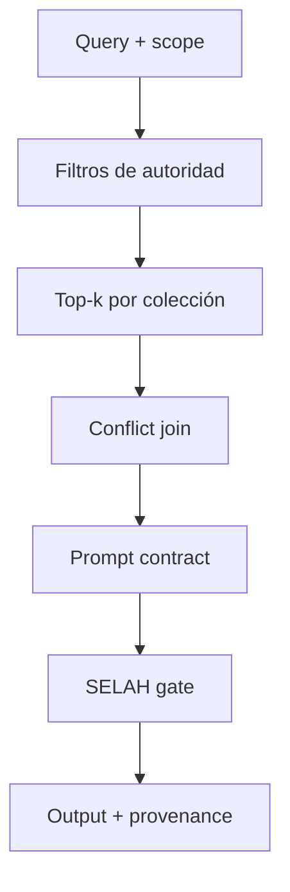

# Arquitectura RAG

## Principio

RAG es la estructura base de reconstrucción, no una excusa para mezclar proyectos. Recupera evidencia filtrada; los gates deciden si puede intervenir en un output.

## Colecciones

| Colección | Contenido | Generación |
|---|---|---|
| `sources_evidence` | upstream y registros | nunca directa |
| `validated_records` | hechos normalizados | con filtro |
| `line_specs` | contratos de línea | con aprobación |
| `module_specs` | módulos y rutas | sí, dentro del contrato |
| `skill_specs` | interfaces de skill | sí, si se activa |
| `artifact_templates` | plantillas N2 | con línea aprobada |
| `qa_decisions` | gates y dictámenes | gobierna, no redacta |
| `handoff_deltas` | continuidad METANO_IA/CMP | rehidratación |

## Retrieval contract

1. Filtrar por `status`, `authority`, `domain` y versión antes de similitud.
2. Excluir `UNKNOWN`, `BLOCKED` y `DISCOVERY_ONLY` de generación.
3. Resolver `source_ids` y hashes antes de componer.
4. Mantener `package_version` separado de `line_version`.
5. Devolver citas internas por `record_id` y `content_path`.
6. En contradicción, devolver ambas afirmaciones y el `conflict_id`.

## Flujo

## Estado real

El índice documental está construido. No se generaron embeddings, vector store, API, scheduler ni sincronización externa. `rag_runtime_state = NOT_BUILT`.
