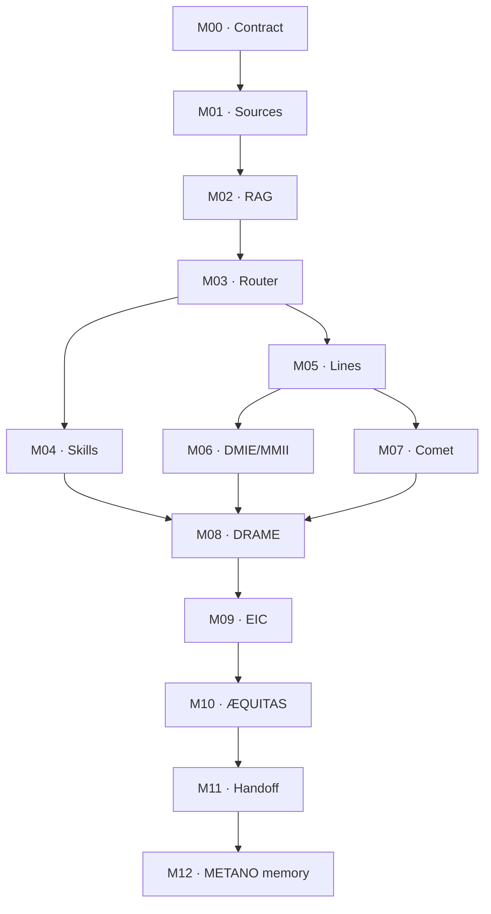

# Execution graph



## Router minimum output

```json
{
  "owner_module": "M08_DRAME_COMPOSER",
  "source_ids": ["SRC-BOS-V2"],
  "line_id": "LINE-LITERATURE",
  "skill_ids": ["SK-CRAFTER"],
  "mode": "dry-run",
  "blocked_by": []
}
```
