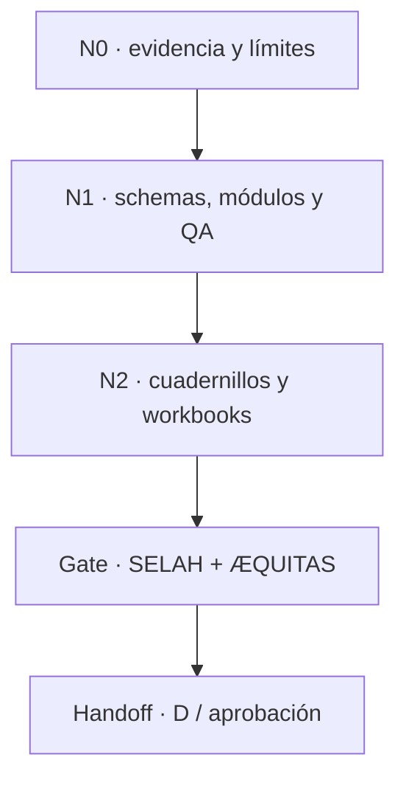
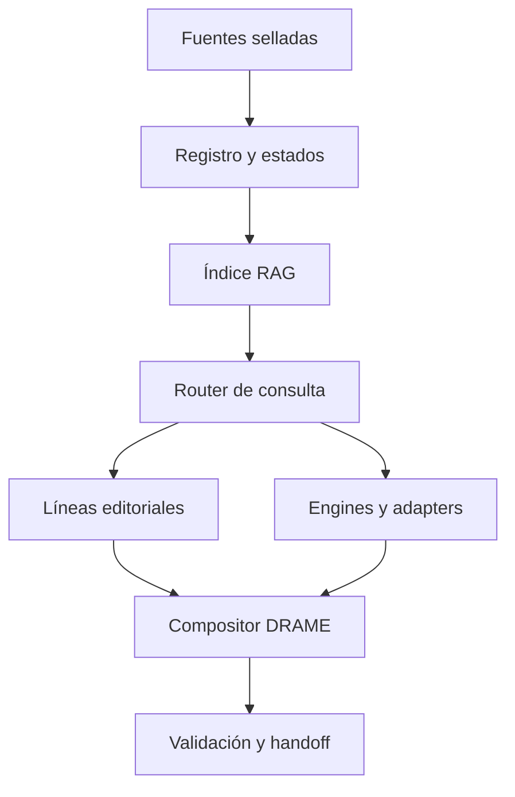
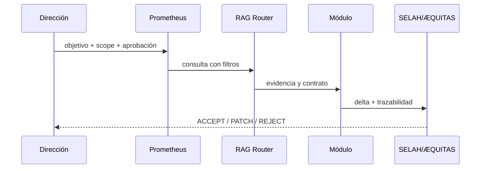

# Arquitectura unificada

## Capas documentales

`N0` gobierna la verdad disponible. `N1` transforma esa verdad en contratos ejecutables. `N2` contiene objetos humanos, nunca autoridad por sí mismos.

## RAG por función

La recuperación exige filtros de `status`, `authority`, `domain`, `package_version` y, cuando aplique, `line_version`. La similitud semántica nunca decide autoridad.

## Ejecución gobernada

Prometheus coordina una sola corrida; no sustituye la decisión editorial. SELAH bloquea mutaciones no autorizadas y ÆQUITAS califica el objeto resultante.
