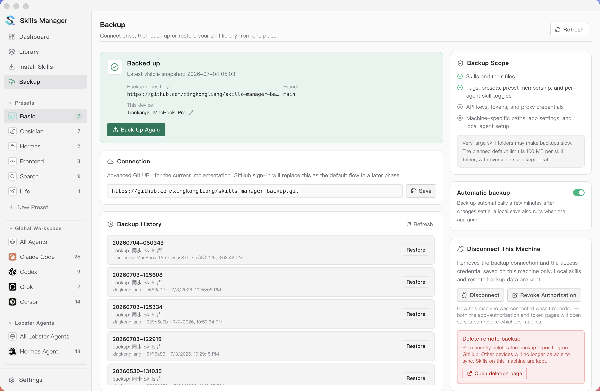

<p align="center">
  
</p>

<h1 align="center">Agents Manager</h1>

<p align="center">
  Manage Skills, Instructions, and MCP connections across coding agents, projects, and SSH hosts.
</p>

<p align="center">
  <a href="https://github.com/Yis-company/skills-manager">Yis-company/skills-manager</a>
</p>

<p align="center">
  
</p>

<p align="center"><strong>Install Skills — Marketplace</strong></p>
<p align="center"></p>

<p align="center"><strong>Global Workspace</strong></p>
<p align="center"></p>

<p align="center"><strong>Agent Workspace</strong></p>
<p align="center"></p>

<p align="center"><strong>Project Workspace</strong></p>
<p align="center"></p>

<p align="center"><strong>Backup & Multi-Device Sync</strong></p>
<p align="center"></p>

<p align="center"><strong>Settings</strong></p>
<p align="center"></p>

## Features

Agents Manager brings three kinds of reusable resources into one Library: Skills, Instructions, and MCP definitions. The same host selector scopes the Library and Global and Project Workspaces; a remote host keeps its own files and library. See [Agents Manager workflows and CLI](AGENTS-MANAGER.md) for deployment reviews, credential references, recovery, and Sync compatibility.

- **Unified skill library** — Install skills from Git repos, local folders, `.zip` / `.skill` archives, or the [skills.sh](https://skills.sh) marketplace. Everything goes into one central repo, which defaults to `~/.skills-manager` and can be customized in **Settings**.
- **Instructions** — Edit supported instruction files in place or save reusable bundles with linked documents. Review deployments against the current project before applying them; library edits never silently change deployed files.
- **MCP connections** — Add definitions manually, import supported configurations, or browse the official MCP Registry. Review commands, arguments, and credential references before saving or deploying. The target agent handles process startup and authentication.
- **Marketplace** — Browse popular skills from the marketplace and find them with keyword search.
- **Create skills** — Write a new skill straight into the library from the Install page or `skills create`, and optionally add it to agents, a preset or a project on any host.
- **Your agents can manage skills** — Claude Code, Codex, Cursor and the rest can install a skill, deploy it to another agent, or report what is where, by driving Agents Manager instead of writing into an agent's folder behind its back — so sources, presets, update tracking and per-agent state stay intact. The Dashboard sets this up in one click; see [Let your agents manage skills](#let-your-agents-manage-skills).
- **Presets** — Group skills into named presets. Library selects the preset you view and edit. In Global Workspace, switch the shared active preset that hosts in Sync follow; review removals before applying. In Project Workspaces, preset actions add or remove skills only in that project. Edited agent copies are preserved for review. The sidebar lists all presets for quick access.
- **Global Workspace** — Each agent gets its own page listing every skill in its global folder — including ones installed outside Agents Manager — so the view always reflects what the agent actually sees. Add or remove skills per agent, or use the All Agents overview to manage every installed agent at once.
- **Project Workspaces** — View and manage project-local skill folders for supported agents, compare them with your central library, and sync changes in either direction. Supports nested skill directories and per-agent assignment when exporting.
- **SSH hosts** — Register remote macOS or Linux hosts in Settings, connect using your existing SSH access, and manage their own library and project paths from the host selector.
- **Linked Workspaces** — Point to any directory as a skills root — useful for skills that live outside the default agent paths. Managed as a standalone workspace without participating in global preset sync.
- **Multi-tool sync** — Sync skills to any supported tool via symlink or copy with a single click. Every skill card shows an agent icon badge per enabled agent — click a badge to install or remove that skill for that agent right from the card, with the badge reflecting live sync state.
- **Add from Library sheet** — In any workspace, click **+ Add Skills** to open a unified picker: search your central library, toggle target agents with always-visible chips (with select-all/clear), and batch-add multiple skills in one click.
- **Batch operations** — Multi-select skills for bulk enable/disable, export, or delete. Project Workspaces also support bulk enable/disable for project-local skills.
- **Skill tagging and filters** — Tag skills, use tags to group similar skills, and filter by source or tag — including an **Untagged** pill to quickly find skills missing labels.
- **Update tracking** — Check for upstream updates on Git-based skills; re-import local ones.
- **Skill preview and source inspection** — Read `SKILL.md` / `README.md`, inspect source metadata, and compare local content with the upstream version inside the app.
- **Custom tools** — Add your own agents/tools with custom skills directories, or override the default path for any built-in tool.
- **Sync across hosts** — Share skills, presets, and the active preset through a Git repository. Inspect host state and compare conflicts before resolving them. Deployment state, overrides, journals, catalog caches, and credentials stay local. See [Sync compatibility](AGENTS-MANAGER.md#sync-compatibility).
- **Activity log & Export Logs** — Install / remove / update / sync operations are recorded locally. Use **Settings → Export Logs** to bundle recent logs and activity history into a single zip for easier issue reports.
- **Flexible app settings** — Configure repo path, sync mode, theme, text size, language, tray behavior, proxy, Git remote, update checks, and the order agents appear throughout the app — all in one place.
- **In-app updates** — The app tells you when a new version is out and installs it for you on macOS and Windows. Nothing downloads or installs on its own: checking only notifies, and installing and restarting each take a click.

## Install

### macOS

Download the `.dmg` for your Mac from the [latest release](https://github.com/Yis-company/skills-manager/releases/latest).

Releases aren't notarized by Apple yet, so the first time you open the app macOS says it "is damaged and can't be opened". After dragging it to Applications, run this once:

```bash
xattr -cr /Applications/skills-manager.app
```

Updates installed from inside the app don't need this.

### Windows and Linux

Download the installer for your platform from the [latest release](https://github.com/Yis-company/skills-manager/releases/latest): `.exe` or `.msi` for Windows, and `.AppImage`, `.deb`, or `.rpm` for Linux (x64 and arm64).

Every installer ships the CLI inside the app — see [Where the binary lives](#where-the-binary-lives).

## Quick Start

1. Add Skills from local folders, Git repositories, archives, or the marketplace; create or import Instructions and MCP definitions in the Library.
2. Choose a local or registered SSH host, then open Global Workspace or a Project Workspace and select the agent and resources to deploy.
3. Review instruction and MCP deployment previews before applying them. Use presets or **+ Add Skills** to manage skills in a workspace.
4. Open **Sync** to connect the shared library, review participating hosts, and inspect history.

## Let your agents manage skills

Claude Code, Codex, Cursor and the rest can install a skill, deploy it to another agent, or report what is where — by driving Agents Manager rather than writing into an agent's folder behind its back. That is what keeps source metadata, preset membership, update tracking and cross-agent deployment state intact.

The Dashboard offers a one-time setup: pick the agents that should be able to do it, and the app installs the [`manage-skills`](skills/manage-skills/SKILL.md) skill and deploys it to exactly those. Afterwards it is an ordinary library skill — adding or removing an agent is the agent badge row on its own card. No PATH setup is involved: the app publishes a copy of its CLI where agents look for it.

It is also published as a skill, so it can be installed without the app:

```bash
npx skills add Yis-company/skills-manager
```

## Sync across hosts

Open **Sync** to connect the shared library through a Git remote and inspect each participating host. Hosts follow the same skills, presets, and shared active preset; each applies changes on its next successful sync. Selecting a preset in Library only changes what you view and edit.

- **Connect:** use the GitHub sign-in or the repository URL controls in this host's Sync details. Add SSH hosts with your existing SSH access; review the host and join effects before continuing.
- **Review:** Needs review offers **Compare changes** before choosing a skill, instruction, MCP, or same-name preset outcome. Review the named versions and affected files, then confirm the choice. Changed versions require a fresh review.
- **Local edits:** edited agent copies remain in place until you compare them and choose **Use Sync version** or **Keep my edit**. Replacing an edited copy preserves it under `edited-backups/` first.
- **Recover:** Sync history retains recovery points. Inspect the host and selected point before restoring.
- **Scope:** portable library resources are shared; credentials and host-specific operational state stay local. Unavailable hosts do not provide current evidence about their files. See [workflow and compatibility details](AGENTS-MANAGER.md#sync-compatibility).

## Supported Tools

Skill management supports 54 agents out of the box, including:

Claude Code · Codex · Cursor · GitHub Copilot · Gemini CLI · GitLab Duo · OpenCode · OpenClaw · Hermes Agent · OpenHands · Cline · Goose · Windsurf · Continue · Grok · Antigravity · Qwen Code · ZCode · Crush · Kilo Code · Roo Code · Amp · Kiro CLI · Droid · TRAE IDE · Warp · Qoder · CodeBuddy

**Settings** lists them all, leading with the ones detected on your machine. You can also add custom tools there and manage their skills the same way.

Instruction and MCP support varies by agent and scope; see the [capability boundaries](AGENTS-MANAGER.md#mcp-connections).

## Tech Stack

| Layer | Tech |
|-------|------|
| Frontend | React 19, TypeScript, Vite, Tailwind CSS |
| Desktop | Tauri 2 |
| Backend | Rust |
| Storage | SQLite (`rusqlite`) |
| i18n | react-i18next |

## Getting Started

### Prerequisites

- Node.js 26.13.1 (the version CI uses; Vite 8 needs 20.19+ or 22.12+)
- [Bun](https://bun.sh) 1.4.4 (the version pinned in `package.json`) for installing packages and running scripts
- Rust 1.99.1 or newer
- [Tauri prerequisites](https://v2.tauri.app/start/prerequisites/) for your OS

### Development

```bash
bun install
bun run tauri:dev
```

`bun install` installs a pre-push hook, except in CI (`CI` set). It runs `bun run format:check`,
`bun run lint`, `bun run typecheck`, `bun run test`, Rust formatting
(`cargo fmt --check`) and strict Clippy (`cargo clippy --all-targets -- -D
warnings`). Bun, Node, Rust, rustfmt and Clippy must be available when
pushing. The checks use the working tree; CI also runs the full build, E2E and
platform-specific Rust tests.

The installer refuses to overwrite an existing hook or change a configured
`core.hooksPath`. If you maintain personal hooks, integrate
`sh scripts/pre-push.sh` into your pre-push hook and run your existing hook
as well. The installer will continue to refuse the conflict; use
`bun install --ignore-scripts` when maintaining that integration yourself.
An install with lifecycle scripts disabled does not install the hook; without
a conflicting hook, run `bun run prepare` to install it afterwards.

When reporting verification, include every observed failure, its cause, and whether
the change fixed it. A passing retry alone does not prove repair. Mark unresolved
failures and checks that were not run explicitly.

### CLI

The repository includes an agent-friendly CLI built on the same Rust shared core used by the desktop app. Both the CLI and the desktop app go through the same SQLite database, central library, and sync engine.

```bash
# Look around
bun run cli skills list
bun run cli skills show db

# Write a new skill straight into the library, optionally adding it with --agent, --preset or --project
bun run cli skills create my-skill --description "When to use it" --body-file notes.md

# Install into the library (does NOT deploy to any agent by itself)
bun run cli skills install ./my-skill
bun run cli skills install https://github.com/foo/bar/tree/main/skills/baz
bun run cli skills install vercel-labs/agent-skills@react-best-practices

# Put it into the agents that should have it, then check
bun run cli skills deploy react-best-practices --agent claude_code --agent codex
bun run cli skills status react-best-practices

# Pull upstream changes, and adopt what an agent already has
bun run cli skills check --all
bun run cli skills update --all
bun run cli skills adopt ~/.claude/skills --dry-run
```

`--help` on any group or subcommand prints the full surface — the groups below
each carry more than these examples show. `--dry-run` is available on selected
commands, including `skills deploy/undeploy/sync/remove/adopt` and
`presets deploy/undeploy/delete`; check each subcommand's help before using it.
`skills remove` requires `--yes` for actual deletion.

Available command groups:
- `repo` — inspect or change the configured base directory
- `agents` (`tools` alias) — list agents, globally enable or disable them, and add custom agents (`add-custom`)
- `skills` — manage the central library and real per-agent deployments (`deploy / undeploy / status`)
- `instructions` — save, inspect, scan, preview, apply, and recover instruction bundles
- `mcps` — inspect capabilities, manage definitions, preview deployments, and recover operations
- `presets` — create, update, delete, organize, deploy, undeploy, and inspect presets
- `git` — operate on the git-backed `skills/` repository (`clone`, `pull`, `push`, `commit`, `versions`, `restore`)

Extra flags:
- `--skills-root <path>` — operate on a cloned/exported skills repo directly instead of the local app default. The manager's state (DB, presets, cache, logs) lives in `~/.skills-manager/external/<name>-<hash>/`, namespaced by the canonical path of the skills root, so the external checkout itself stays clean.
- `--json` — machine-readable output for scripts/agents. Failures print `{"ok": false, "code": …, "message": …}` on stderr with a non-zero exit. A deployment refused because the target is not ours carries the paths as data (`code: "TARGET_CONFLICT"`, `details.conflicts[].path`) so a caller can name the directory in the way instead of quoting a sentence.

```bash
bun run --silent cli --skills-root /path/to/my-skills --json skills list
```

#### Agents inside WSL

The Windows app cannot create links inside WSL, so it can only copy skills there. If your agents live in WSL, run the Linux CLI inside WSL instead — it keeps its own library there and deploys with real symlinks:

```bash
mkdir -p ~/.local/bin && curl -L -o ~/.local/bin/skills-manager-cli \
  https://github.com/Yis-company/skills-manager/releases/latest/download/skills-manager-cli-Linux-x64
chmod +x ~/.local/bin/skills-manager-cli
export PATH="$HOME/.local/bin:$PATH"
skills-manager-cli agents add-custom hermes-work --path ~/.hermes/profiles/work/skills
skills-manager-cli skills install ./my-skill
skills-manager-cli skills deploy my-skill --agent hermes-work
```

#### Where the binary lives

At startup the app publishes a copy of its own CLI to `~/.skills-manager/bin/skills-manager-cli`, always matching the running app, so agents can find it without anything on your PATH. A `.version` stamp beside it is written only after the copy is verified and removed before each republish, so a copy that failed — a binary held open on Windows, say — is never presented as usable.

Putting the CLI on your *own* PATH, for typing commands yourself, is separate:

```bash
bun run cli:install
# equivalent to:
# cargo install --path src-tauri --bin skills-manager-cli --locked --force
```

This drops the binary at `~/.cargo/bin/skills-manager-cli`. Re-run after pulling updates to refresh it.

Official releases also publish standalone CLI binaries for macOS arm64/x64, Windows x64, and Linux x64. Download the matching `skills-manager-cli-*` asset, make it executable on macOS/Linux, and place it on PATH.

#### Concurrent use with the desktop app

The CLI and desktop app share the same SQLite database and repository lock. The app's filesystem watcher normally refreshes after CLI metadata or deployment changes. If the app was suspended while a command ran, trigger one manual refresh.

#### Updating a remote connection

Remote connections require the CLI version to match the local desktop app. When a connection reports a different version, choose **Review update**, or use the update action after checking the host in Settings. Review the host and versions, then install the matching version and reconnect.

The app downloads the matching macOS or Linux CLI from `Yis-company/skills-manager`, transfers it using your existing SSH access, and selects a separate versioned CLI for that connection. It keeps the remote desktop app, its published CLI, and your skill library in place. No remote internet access or `sudo` is needed. An unpublished version or unsupported platform produces an error without changing the selected CLI.

Desktop update checks and installation also use `Yis-company/skills-manager`. Editing a checkout does not change an already installed app.

### Build

```bash
bun run tauri:build
bun run cli:build
```

### Changesets and releases

Every PR that changes the app (`src/`, `src-tauri/`, `skills/` and similar) needs a changeset, which the **Changeset** check enforces:

```bash
bun run changeset          # pick patch/minor/major and describe the change
bun run changeset --empty  # an app change that doesn't need a changelog entry
```

Changes to docs and CI don't need one.

Once changesets land on `main`, the **Version** workflow opens a `chore: version packages` PR. That PR bumps every version file and writes `CHANGELOG.md`. Merging it tags `vX.Y.Z` and starts the **Build & Release** workflow. Merging the version PR is the only way to cut a release. Don't push `v*` tags by hand.

If the release build fails after the tag exists, merging again won't retry it, because the Version workflow won't release a tag twice. Once the cause is fixed, do one of these:

- Re-run the failed jobs from the Actions tab. They build the same tagged commit.
- If the fix is in the workflow or in repo secrets, start a new run on the tag:

  ```bash
  gh workflow run release.yml --ref vX.Y.Z
  ```

  If it then fails on assets already attached to the draft release, delete that draft and run it again.

If the fix needs a code change, merge it with a changeset and release the next version instead. A tag always stays on the commit it was cut from.

## Troubleshooting

[Open an issue](https://github.com/Yis-company/skills-manager/issues), and attach the bundle from **Settings → Export Logs**.

## Credits

Agents Manager builds on [skills-manager by xingkongliang](https://github.com/xingkongliang/skills-manager). We thank the original author and contributors for their work.

## License

MIT
